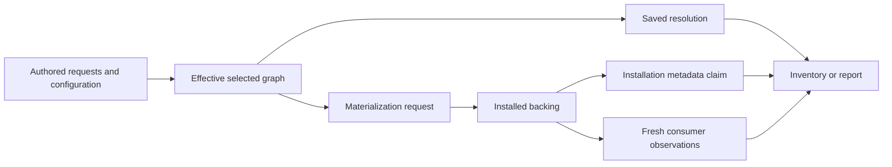

# Package-manager ownership and compatibility targets

npm, pnpm, and Yarn need distinct correction boundaries. Preserve their existing resolution policies and formats while separating authored intent, selected graphs, cached installation claims, actual backing, and externally acknowledged effects. The owning reports already contain the native counterexamples and executable models; this review connects them to affected source owners and implementation choices rather than rerunning those fixtures.

The selected profiles remain npm 11.20.0 / Node 26.13.1, pnpm 12.21.0's native executable, and Yarn Berry 4.19.0 / Node 26.13.1. Yarn Classic is excluded. This is a proposal and compatibility synthesis, not a production patch or claim about newer releases. [Source selections](../sources/js-architecture-selections.json) verify nineteen retained files, with three npm files also matching installed source. New inspection ranges are separate from the owning ledgers' earlier inspections. pnpm/Yarn source-to-binary reproduction remains unproved.

## Responsibility map

The diagram describes different authorities, not a shared installation order or library design:

The npm counterexample writes desired metadata into an installed-index role without establishing the matching backing. The pnpm patch counterexample retains an unexpected live target after a failed candidate and later successful reuse. Yarn's version-decision counterexample consumes author intent before its manifest effect. These failures concern different edges and cannot be repaired by renaming every result “verified.”

| Application target | Owning proposal | Current behavior to preserve |
| --- | --- | --- |
| npm | [Installed-index truth and operation results](npm.md) | Raw direct-declaration protection, nested overrides, distinct lock-only/ordinary/clean installation, and acknowledgement after publication. |
| pnpm | [Backing admission and protected deployment](pnpm.md) | Peer-context identity, wanted/current graph and layout policy, explicit patch meaning, forcing versus compatible convergence, and source/target separation. |
| Yarn Berry | [Phase-bound persistence and configuration](yarn.md) | Ordered resolution rules, descriptors/locators, separate resolve/fetch/link phases, relative deferred decisions, bounded constraint evaluation, and configuration provenance. |

[Contract records](contracts.json) connect these decisions to exact source owners, current evidence, alternatives, compatibility, and remaining checks. They are research records, not a new SDK or wire schema.

## Shared reporting direction, separate implementations

Each product can expose its existing operation facts through a scoped result: requested mode and targets, effective policy, saved metadata changes, materialization or link outcome, hook/task outcome, and unknown or partial effects. Field names in these reports are illustrative. Do not change existing SDK return values or default JSON shapes merely to impose a common report. Prefer the existing owning types and an opt-in/versioned structured view where a new public contract is needed.

An applied edit is not a verified postcondition. A current lock is not installation evidence. A publication acknowledgement is not erased by a later hook failure, and a lost response does not establish that nothing happened. Keep these facts attributable instead of inferring them from exit status or a generic phase clock. Source- and model-derived interpretations remain different from observed runtime evidence.

No universal transaction manager, second resolver, new package registry, or frontend-only configuration evaluator is selected. Fix a demonstrated invariant at its existing owner, then expose the result. Conservative refusal or explicit unknown state is preferable to claiming backing or publication that was not established; that does not authorize weakening known dependency, integrity, or ownership guards.

## Evidence and release obligations

The linked reports retain exact native versions, source scopes, models, controls, original harness failures, and unavailable cases. This review reads source and retained records only. It creates no new native mutation, model, kernel replay, upstream report, or release qualification. The public source subset contains no package stores, credentials, or personal projects.

Before a production decision, review current upstream status, compare old and candidate behavior on the same captured inputs, and exercise the specific source/host boundary that could falsify the correction. Preserve historical observations even if a newer version changes the result. Existing formats and public command meanings belong to each comparator; empack's proposed project-format clean break does not authorize changing them.

The full application study remains open. General solvers, peer/workspace/protocol combinations, hooks and plugins, PnP, store reclamation, concurrent owners, interruption, registry durability, and all supported platforms retain their specific outstanding obligations. This synthesis supplies an implementation direction and compatibility plan for the recorded findings, not full program conformance.
