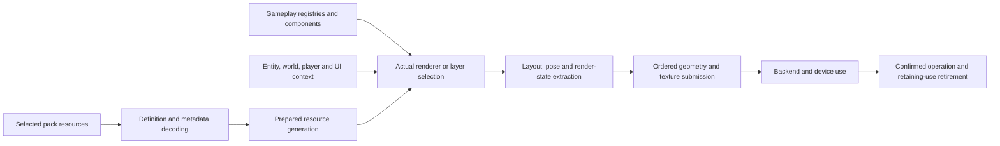

# GUI, equipment, entity, and biome presentation

This band maps four additional presentation surfaces across all five selected Java releases. The [ledger](presentation-sources.json) binds 260 original-class pairings, 158 private inspection views, 131 type-scoped field locators, and 325 built-in asset structures or PNG headers. These counts describe the selected slice. They do not establish complete schemas, every entity/renderer, all provider extensions, or rendered qualification.

[Source collection](inspect_presentation_sources.py) freezes an explicit five-profile input manifest and verifies existing client, metadata, mapping, named-artifact, decompiler, and Java identities. It runs one bounded inspection process at a time without initializing game classes. [Regeneration](presentation_sources.py) checks the original/named class pairs, views, producer snapshots, raw inspection channels, and process retirement. Decompiled text remains an unverified inspection aid; original code, assets, binaries, and views stay private.

An identifier in one node does not supply the context, registration, or lifetime of another. Resource decode, model availability, renderer construction, state extraction, command submission, and visible output need independent outcomes.

## GUI sprite definitions and consumers

All five selected versions declare the `gui` metadata section with optional `scaling`, default Stretch. The native fixture below calls the scaling codec directly; it does not exercise the enclosing metadata-section loader or missing-metadata fallback.

| Variant | Selected source fields | Consumer distinction |
| --- | --- | --- |
| Stretch | Unit record selected by `type: stretch`. | Uses destination dimensions. The retained original codec accepts the authored extra zero/negative dimension fields; those fields do not become Stretch dimensions. This is not a universal unknown-field policy. |
| Tile | Positive integer `width` and `height`. | Tile dimensions differ from the destination rectangle, texture dimensions, clipped final tiles, and later vertex generation. |
| Nine-slice | Positive integer `width`/`height` and required `border`. | Border has a positive scalar alternative or a record of four nonnegative sides. Validation adds opposite sides using Java `int` arithmetic. |
| Later nine-slice option | `stretch_inner`, Boolean default false, in the selected 1.21.4, 1.21.5, 1.21.11, and 26.3 sources. | It chooses stretching versus tiling in the inspected inner-segment path. The selected 1.21.1 record has no such field; its codec accepts the authored extra flag without acquiring that capability. |

The distinction between scalar and record borders matters: scalar zero is refused, while a four-zero record is accepted. A normal eight-pixel definition with opposite borders four and four is refused because it has no center under the selected guard.

The guard also has a signed-arithmetic boundary. With width 8, left 2147483647, and right 1, the addition wraps to a negative Java `int` and passes the horizontal comparison. Three authored overflow cases per release are accepted: 15 counterexamples to replacing this guard with unbounded natural addition. They do not establish a rendered failure or a generally supported large-border design.

The actual inspected drawing methods separately clamp each destination border to at most half the corresponding destination dimension. They branch on destination size, compute source/UV segments, and select tiling or stretching. The later GUI extraction path records render state, with a separate vertex-building consumer. Destination clamping is not the same predicate as codec admission, complete UV correctness, bounded work, or final device retirement. No drawing method was executed here.

[Original-codec collection](native_gui_scaling.py) reuses the authored [CodecProbe](CodecProbe.java) and pinned client/library bytes. Fourteen integer/Boolean requests on each release give **70 codec outcomes**, with 40 accepted dimension pairs independently checked. macOS arm64 Java 21 handles the earlier four targets; explicit Java 25 handles 26.3. The collector freezes requests, producers, binding/class identities, raw channels, and owned process-group retirement. [Export](export_gui_scaling.py) verifies private artifacts before publishing authored cases and reduced receipts.

[Lean](GuiScaling.lean) has 15 laws and reuses the shared [Java word contract](../java/WORD32.md). [Bend](GuiScaling.bend) has eight kernel-checked laws and independently uses the shared U32 sign rule. The [case decoder](GuiScalingCase.lean) admits only the selected variant, bounded integer magnitudes, explicit border-shape facts, and version/flag profile. The [pure comparison](gui_scaling_conformance.py) matches all 70 outcomes, checks dimension readbacks, rejects ten research requests and five changed native observations, and retains the 15 natural-addition counterexamples in its [receipt](evidence/gui-scaling-conformance.json).

The older [natural-dimension model](Decoding.lean) explicitly excludes signed overflow and remains valid for its retained smaller fixtures. This extension does not rewrite those original observations. Neither model proves the full JSON/numeric grammar, arbitrary constructors, drawing, accessibility, pixel output, or Windows/Linux native behavior.

## Equipment definitions and actual layer selection

| Selected release | Source contract change |
| --- | --- |
| 1.21.1 | The inspected humanoid armor path selects actual ArmorItem/material layers, item slot, dye tag/component, trim, and foil. It is not the later EquipmentClientInfo path. Missing that selected class is not a claim that older armor has no resources or other extensions. |
| 1.21.4 | EquipmentClientInfo declares nonempty `layers` with nonempty lists and six LayerType labels. AssetManager reads `equipment/*.json`; selected missing lookup returns an empty built-in object. |
| 1.21.5 | Fourteen LayerType labels include saddle contexts. A matching label does not create the corresponding entity, component, geometry, or registration in an older runtime. |
| 1.21.11 | Eighteen selected labels include additional animal contexts. Rendering depends on that release's model/state and submission interfaces. |
| 26.3 | Nineteen labels include `humanoid_baby`. Optional `trim_overrides` adds ordered predicates and texture/palette selection. |

The later layer record requires a texture identifier, optionally declares `dyeable`, and defaults `use_player_texture` to false. The dye record optionally uses the runtime RGB-color codec for `color_when_undyed`; its complete delegated grammar is not inferred here. The selected texture consumer constructs `textures/entity/equipment/<layer type>/<texture path>.png` while preserving the identifier's namespace.

In the inspected layer renderer, dyeable layers use a supplied item dye color when nonzero, otherwise the optional undyed color made opaque, otherwise zero. Zero suppresses that layer; a nondyeable layer uses the ordinary untinted value. A declared player-texture preference uses a supplied override only when one is present. The filename alone supplies neither a player context nor a valid texture.

Foil and trim behavior is versioned. The selected 1.21.5 renderer consumes foil on the first rendered layer and obtains a trim sprite separately. The 26.3 path suppresses the initial shader-glint choice when a supported trim is present, submits the trim, and can submit a later glint pass; it excludes baby humanoid trim on this path. These are source interpretations, not a pixel-equivalence or all-renderer rule.

For 26.3, each trim override requires at least one of `texture`/`palette`; its `when` predicate requires at least one of `material`/`pattern`. Present predicate constraints combine with AND. The actual texture consumer takes the **first matching override**, replaces texture when supplied, and sets palette to the supplied palette or null. A texture-only match therefore suppresses the original palette on this selected path; it is not simply a fieldwise merge preserving every omitted value. Palette preparation returns a texture handle used by submitted model work. Registry lookup, actual palette/image preparation, failed allocation, cache invalidation, and retaining uses remain unqualified.

AssetManager publication, equipment lookup, an Equippable component, actual item slot, selected LayerType, baked model, dye/trim data, player override, and renderer/backend are separate dependencies. A missing lookup's built-in empty object is not proof that the wire codec accepts an empty author definition. No equipment renderer, item/equipment registry, palette loader, game entity, or GPU operation was run in this band. The earlier [bounded equipment parser comparison](DECODING.md) retains its own scope.

## Entity models, context, and render-state generations

The inspected vanilla model-set path uses programmatic LayerDefinitions roots keyed by ModelLayerLocation; baking an unknown layer throws. The 1.21.1 listener rebuilds its roots during reload. The selected 26.3 `vanilla()` constructor captures roots, while a public model-set constructor also accepts a supplied root map. These paths do not establish a resource-pack entity-geometry JSON language or exclude mod-supplied alternatives.

EntityRenderDispatcher constructs actual renderer instances using a context containing model, resource, font, texture, item/equipment, and release-specific services. In 26.3, entity state extraction and submission are separate methods, and reload assigns entity, avatar, and mannequin renderer maps in sequence. The existence of a reload callback does not prove atomic publication of all dependent maps or the retirement of earlier state/texture users. No reload fault or stale-state defect is alleged from that sequence alone.

Pose, animation, equipment, visibility, camera, light, entity type, player-model type, and renderer-specific state are inputs that an asset converter cannot invent. A resource identifier, cached mesh, or extracted state cannot independently prove that the current renderer/context accepts it. The selected entry points are not an audit of every concrete entity, special renderer, animation, culling rule, or custom provider.

## Colormaps, biome context, and publication

The selected grass and foliage reload listeners prepare pixel arrays from fixed colormap resource paths and publish them through the corresponding static `init` method. The later selected releases include the separate dry-foliage lane. The ledger records two built-in colormap PNG headers in 1.21.1/1.21.4 and three in the later three targets. Header dimensions are not decoded pixel identity, image-format acceptance, or observed rendering.

The selected color helpers retain the supplied pixel array; their climate lookup computes a temperature/rainfall-dependent index and has a fallback for an index beyond the array length. Later helpers delegate that computation to ColorMapColorUtil. This is not a complete validation policy for arbitrary doubles, negative indices, short arrays, external mutation, or all callers. No native color-helper or image-loader calls were performed here.

BiomeColors delegates averaging to the actual world/block-tint interface and distinct color resolvers. Block color registration and item color sources can select fixed colors, biome/world context, or a default where context is unavailable. A recolored PNG is therefore not a proof of an equivalent biome algorithm, world-blending policy, seasonal provider, shader output, or item fallback. Runtime biome registries and every concrete callback remain part of consumer closure.

## Host, provider, and design implications

- Preserve the original signed-arithmetic and version profile when compatibility is required. A stricter authoring validator can reject overflow-shaped borders, but must label that policy separately from current codec acceptance. The corpus does not select a product fix.
- Model definition dimensions, destination rectangle, source texture/UVs, clipping, layout scale, extracted state, submitted work, and visible output separately. Diagnostics should identify the failed stage and retained usable state instead of calling a parse “applied.”
- A conversion can preserve a bounded texture/layer case only after resolving its actual slot, component/registry, geometry, color/trim, player, and backend dependencies. Missing older gameplay data and model registrations are unsupported inputs, not implicit defaults.
- Staged generation publication and leases are possible designs for equipment/model/colormap/GUI state. They need actual synchronization and cleanup owners; a copied metadata map or accepted state record does not establish GPU retirement or physical reclamation.
- Modefite, Polytone, Compat, and custom renderers need their actual registration, metadata ownership, injection order, reload, and fallback contracts. Their earlier scoped item/model or manager evidence does not qualify these four domains. No provider installation, replacement, or new combined mod is selected here.
- Bedrock remains an independent edition lane; these Java model sets, equipment fields, GUI dispatch, and world-color callbacks are not Bedrock contracts.

Full delegated grammars, all definitions and concrete consumers, actual providers/coexistence, native image/model/palette and device effects, rendering/accessibility, other host profiles, complete failure/recovery, and final three-intent qualification remain unfinished. This is research and proposed design work, not implementation or rollout.
